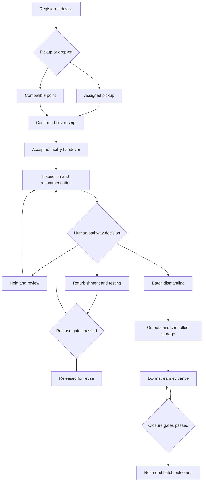
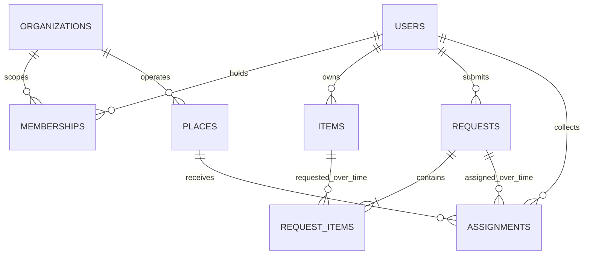
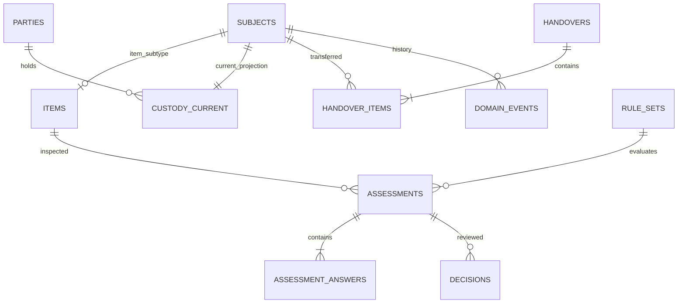
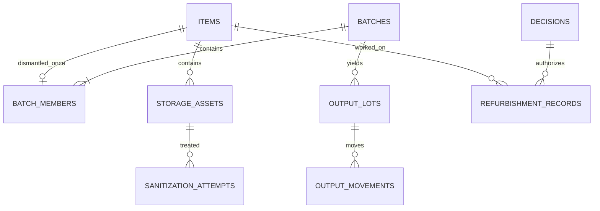
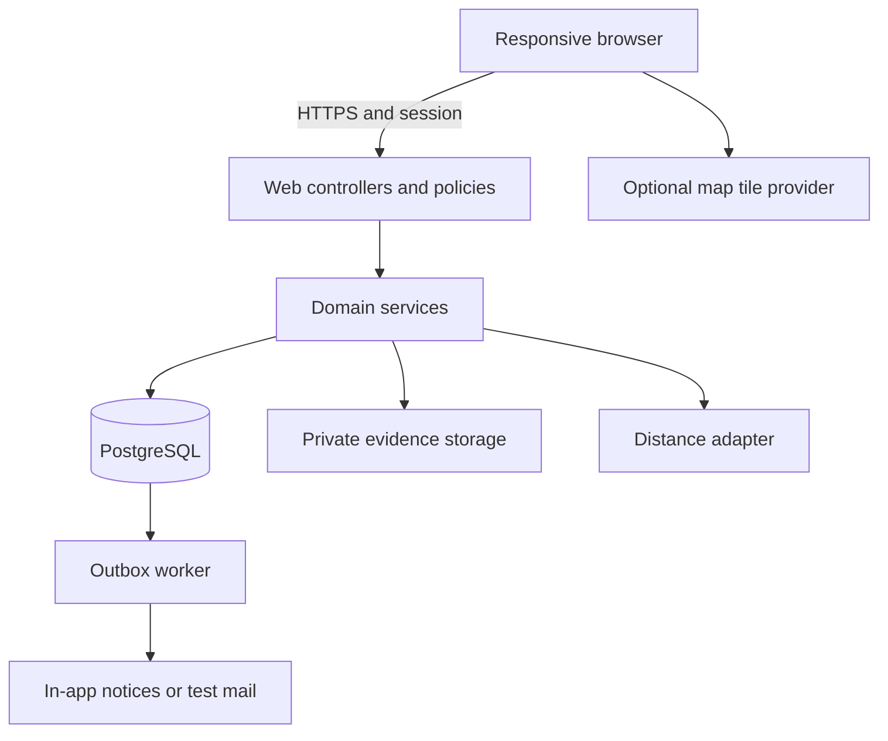

# Deliverable 3 — Detailed System Modelling & Design

**Project:** Smart E-Waste Collection, Tracking and Recycling Management Platform for Kenya  
**Case study:** Nairobi County  
**Design baseline:** D3 v1.0 — 3 October 2026  
**Requirements authority:** Deliverable 2, D2 v1.0  
**Status:** Complete design specification for review and implementation planning. No application has been implemented or tested by this document.

## 1. Purpose, continuity and evidence

This document translates the 35 P0 functional requirements, 12 quality requirements and 20 business rules in D2 into user stories, use cases, workflows, an information model, architecture, algorithms, screen specifications and evaluation procedures. D2 remains authoritative for scope. The design adds implementation detail, not new product workflows.

Preserved boundaries: Nairobi case study; common consumer/ICT devices; consumer, collector, processor and administrator roles; responsive web; QR/unique-ID custody; constrained route optimization; explainable human-reviewed assessment; supporting sanitization records; batch lineage after dismantling. Numeric scores, observer login, rewards, blockchain, native apps, autonomous AI, illegal-dumping case management and official integrations remain outside P0.

Evidence labels throughout are **E: verified public technical capability**, **I: engineering inference**, **A: project design assumption/choice**. Operational evidence is inherited from D2's source register and not represented as new interviews. New architecture and inspection rules below are design choices. Synthetic data does not establish real-world performance, clinical/safety expertise, user acceptance or statutory compliance.

New decisions are recorded as ADR01–ADR08. They refine previously open architecture choices without changing P0 acceptance criteria. All future scope changes follow D2's change log. The chapter sequence below follows the seven parts agreed for Deliverable 3.

## 2. User stories and use cases

### 2.1 User stories

| Story | Actor and goal | Value | Acceptance summary | FR links |
|---|---|---|---|---|
| US01 | As a user, I want secure access and recovery | Protect my records | Suspended access denied; logout and recovery invalidate prior credentials/tokens | FR01, FR02 |
| US02 | As an admin, I want reviewed operators and points | Schedule with eligible participants | Review evidence/status retained; inactive operators/points unavailable for new work | FR03, FR04 |
| US03 | As a consumer, I want to register each device | Identify what I am handing over | Unique ID; unknown serial allowed; duplicate warning; source of condition retained | FR05, FR06 |
| US04 | As a consumer, I want eligible pickup/drop-off options | Choose a practical handover | Service/category/hazard checks and compatible points; no map dependency | FR04, FR07, FR08 |
| US05 | As a consumer, I want to change an uncollected request | Avoid unwanted or missed visits | Cancellation/rescheduling affects eligible items only and preserves attempts | FR09 |
| US06 | As an admin, I want acknowledged assignments | Know who will collect and receive | One active assignment; operator eligibility checked again at execution | FR10 |
| US07 | As an admin, I want constrained route suggestions | Coordinate collection efficiently | Frozen inputs; feasible plans; unserved reasons; baseline comparison | FR11–FR14 |
| US08 | As a collector, I want an ordered manifest | Complete assigned work | Approved plan only; private addresses limited to active assignment | FR02, FR14 |
| US09 | As staff, I want QR or manual lookup | Identify the correct physical item | Lookup is authorized and does not itself change status | FR15 |
| US10 | As a collector/point attendant, I want item-specific receipt | Record actual collection | Evidence/acknowledgment; partial pickup updates only received items | FR16 |
| US11 | As sender/receiver, I want an acknowledged handover | Preserve custody accountability | Pending transfer until acceptance; discrepancy blocks routine progression | FR17, FR18 |
| US12 | As a processor, I want structured inspection and explanations | Make consistent pathway decisions | Category rules; unknown/hazard handling; versioned reasons | FR19, FR20 |
| US13 | As a processor, I want to approve or override advice | Retain professional responsibility | Original recommendation retained; override reason mandatory | FR21 |
| US14 | As a processor, I want to record work and sanitization | Release devices only after required gates | Functional test and data gate before reuse; failed work can enter recycling | FR22, FR23 |
| US15 | As a processor, I want batch/material lineage | Trace outcomes after dismantling | Parent IDs remain linked; measured balance and downstream evidence | FR24–FR26 |
| US16 | As a consumer, I want a filtered timeline | Understand the outcome of my device | Own milestones and batch link; no other owners or private operational data | FR27 |
| US17 | As an admin, I want controlled exceptions and corrections | Resolve mistakes accountably | Append corrective events; cannot silently erase custody history | FR28, FR29 |
| US18 | As a user, I want relevant notifications | Know when action or a milestone changes | Recipient scope; read state; no duplicated event notifications | FR30 |
| US19 | As admin/processor, I want accurate filtered reports | Understand recorded activity | Unique counts; measured/estimated mass separated; scoped CSV | FR31, FR32 |
| US20 | As a consumer, I want access/correction/deletion requests | Exercise control over personal information | Versioned notice; tracked request; redaction separated from non-identifying lineage | FR33 |
| US21 | As an evaluator, I want safe reproducible experiments | Assess the prototype fairly | Atomic/idempotent commands; labelled seeds and versioned outputs | FR34, FR35 |

### 2.2 Use-case index

| Use case | Primary actor | Related stories | Requirements | D2 test family |
|---|---|---|---|---|
| UC01 Access/recover account | All users | US01 | FR01–FR02 | AT01 |
| UC02 Review operator/point | Admin | US02 | FR03–FR04 | AT02 |
| UC03 Register device | Consumer | US03 | FR05–FR06 | AT03 |
| UC04 Submit collection request | Consumer | US04 | FR04, FR07–FR08 | AT02–AT03 |
| UC05 Change request/record attempt | Consumer/collector/admin | US05 | FR09 | AT03 |
| UC06 Assign collection | Admin, collector | US06 | FR10 | AT02, AT11 |
| UC07 Plan/compare/approve routes | Admin | US07–US08 | FR11–FR14, FR35 | AT04 |
| UC08 Identify and collect | Collector/point staff | US09–US10 | FR15–FR16 | AT03, AT05–AT06 |
| UC09 Transfer/receive custody | Collector, processor | US11 | FR17–FR18 | AT06, AT11 |
| UC10 Inspect and approve pathway | Processor | US12–US13 | FR19–FR21 | AT07 |
| UC11 Record sanitization | Processor | US14 | FR23 | AT08 |
| UC12 Refurbish/release or redirect | Processor | US14 | FR22, FR26 | AT08 |
| UC13 Dismantle/create batch | Processor | US15 | FR24 | AT09 |
| UC14 Record outputs/downstream outcome | Processor | US15 | FR25–FR26 | AT09 |
| UC15 View timeline and notifications | Authorized users | US16, US18 | FR27, FR30 | AT05, AT10 |
| UC16 Resolve exception/correct record | Admin/authorized processor | US17 | FR28–FR29 | AT06, AT09–AT11 |
| UC17 View/export reports | Admin/processor/collector | US19 | FR31–FR32 | AT10 |
| UC18 Process privacy request | Consumer/admin | US20 | FR33 | AT10 |
| UC19 Run evaluation | Evaluator through local test tools | US21 | FR34–FR35 | AT04, AT11–AT12 |

The evaluator is a development/testing responsibility, not a fifth deployed operational role. Organization/regulator stakeholders consume privacy-filtered aggregate reports generated by admin; no observer login is added.

### 2.3 Detailed use cases

Common safeguards for every mutation: authenticate; authorize role and record scope; validate payload; check expected object version; reserve idempotency key; lock affected records in stable order; recheck state/eligibility; commit state, domain event and notification-outbox entry in one transaction. Errors leave business state unchanged. Receipt retries return the first result. A reused idempotency key with a different payload returns a conflict. See Section 5.5.

#### UC01 — Access and recover account

- **Trigger/preconditions:** user opens login, logout or recovery; account exists except for consumer registration.
- **Normal flow:** user submits credentials; system applies throttling and active-status check; successful login rotates session and displays permitted home. Logout invalidates session. Recovery request gives the same response for known/unknown email; valid single-use token permits a new password and invalidates existing sessions.
- **Alternatives:** consumer self-registers with email/password and notice acknowledgment; staff roles cannot be self-selected. Missing/invalid credential, suspended account, expired/reused token or throttled request is rejected without account enumeration.
- **Postcondition:** authenticated scoped session or unchanged denied access; token consumed atomically on success.
- **Data/output:** user, session, recovery token hash, notice acknowledgment; audit security result without password/token contents.

#### UC02 — Review operator, facility and point

- **Trigger/preconditions:** administrator opens operator/point management.
- **Normal flow:** record organization/facility, supported categories, contact, hours, coordinates and evidence; mark synthetic where applicable; review with date/reason; activate compatible points.
- **Alternatives:** incomplete evidence remains pending; suspension blocks new assignments and opens a review task for live work. Point closure cancels selection availability without deleting existing records. No automatic regulator-certification badge.
- **Postcondition:** versioned reviewed status or recorded pending/suspended state.
- **Data/output:** organization, place, review event, attachments, categories; revised eligibility view.

#### UC03 — Register device

- **Trigger/preconditions:** consumer registers one physical supported device.
- **Normal flow:** choose category; enter optional model/identifier/photo, observed condition, data-bearing and hazard answers including unknown; validate; flag possible duplicate; create permanent ID and owner custody; show label and next action.
- **Alternatives:** unknown serial allowed; photo upload failure leaves form available; duplicate remains a warning for review; excluded category gives a clear scope message. Draft editing creates observation revisions; committed observations remain retained.
- **Postcondition:** one device ID, private owner link, initial event and observation version.
- **Data/output:** tracked subject, item, identifier reference, observation, attachment; QR/manual code with no personal payload.

#### UC04 — Submit pickup/drop-off request

- **Trigger/preconditions:** consumer selects own eligible intact items with no active request.
- **Normal flow:** choose mode; confirm address/pin or compatible point, preferred date, contact and item mass estimates; validate geography/category; request submitted and items reserved; admin reviews eligibility.
- **Alternatives:** out-of-area/incompatible point rejected; unknown hazard requires review and cannot enter normal scheduling; denied geolocation uses manual coordinates/address; simultaneous requests for one item produce one success only.
- **Postcondition:** request submitted/reviewable; active reservation for each accepted item. No promise of a pickup date before scheduling.
- **Data/output:** request, request items, private location/contact, category/service-area version; review notification.

#### UC05 — Cancel, reschedule or record collection attempt

- **Trigger/preconditions:** consumer changes eligible outstanding work, or assigned collector records an attempted visit.
- **Normal flow:** select outstanding request items; confirm cancellation/reschedule reason; invalidate affected route/assignment as needed; release only cancelled reservations. Collector records failed attempt with time and reason; admin reschedules eligible remainder.
- **Alternatives:** received items cannot be cancelled; multi-item request becomes partially completed when only some are received. A closed request with mixed collected/cancelled outcomes is labelled completed with exceptions, not fully collected.
- **Postcondition:** prior attempts retained; no duplicate receipt or reversal of custody.
- **Data/output:** request-item outcomes, attempts, corrective route version/invalidation event.

#### UC06 — Assign and acknowledge work

- **Trigger/preconditions:** request reviewed; eligible operator and receiving facility available.
- **Normal flow:** admin selects collector/facility; system locks outstanding job; creates offered assignment; collector acknowledges or declines; accepted work enters route planning.
- **Alternatives:** second admin assignment conflicts; declined offer returns for reassignment; operator becomes suspended before acceptance/execution, so new work is blocked and admin resolves live obligations.
- **Postcondition:** at most one active assignment per outstanding pickup job.
- **Data/output:** assignment version, review/acceptance events; collector notification.

#### UC07 — Plan, compare and approve routes

- **Trigger/preconditions:** admin selects acknowledged eligible jobs, depot and available fleet.
- **Normal flow:** validate and freeze inputs/matrix; run submission-order baseline and nearest-feasible/2-opt method; display constraints, served/unserved reasons, coverage and distances; admin selects proposed plan; recheck request versions and approve routes; collectors view assigned stops.
- **Alternatives:** missing mass/location or unreachable matrix leg excludes job with reason; no feasible vehicle leaves job unserved; changed request invalidates approval; matrix service failure uses explicitly selected labelled geometric mode, never silently switches within a run.
- **Postcondition:** immutable comparison run plus approved plan version or a retained unapproved proposal.
- **Data/output:** route run, snapshot/hash, algorithm version, routes/stops, metrics; no globally optimal or actual fuel-savings claim.

#### UC08 — Identify and record collection/drop-off

- **Trigger/preconditions:** authorized assigned collector or point staff has the physical device; approved plan required for routed pickup.
- **Normal flow:** scan QR or enter ID; check category/model and selected item; record observation, acknowledgment/evidence and observed time; confirm actually received item; commit custody and first-collection milestone; derive request state.
- **Alternatives:** wrong QR opens mismatch exception rather than recording receipt; camera denial uses manual lookup; missing item remains outstanding; returned device starts a linked new lifecycle; retries return original receipt.
- **Postcondition:** only physically acknowledged items gain confirmed custody; request may be partial.
- **Data/output:** collection attempt, custody event, request item, receipt/evidence; owner notification.

#### UC09 — Initiate, accept or dispute handover

- **Trigger/preconditions:** sender is confirmed custodian; receiving party is permitted; item not blocked for this transition.
- **Normal flow:** sender selects subjects and recipient; records manifest/evidence; transfer pending; recipient inspects each subject and accepts matching items; accepted transfer advances current custody and facility-received milestone if applicable.
- **Alternatives:** wrong/damaged/missing subject disputed individually; no receiver acknowledgment leaves last confirmed custodian unchanged; mixed outcomes allowed; unauthorized receipt denied. Admin resolves discrepancies with evidence but cannot impersonate acknowledgment.
- **Postcondition:** one confirmed custodian per subject, with pending/disputed transfer separate. Routine processing requires accepted facility receipt.
- **Data/output:** handover header/items, acceptance/dispute events and exceptions; filtered receipt.

#### UC10 — Inspect and approve processing pathway

- **Trigger/preconditions:** processor belongs to receiving facility; receipt accepted; unresolved blocking disputes absent.
- **Normal flow:** inspect category-specific questions; freeze answers; apply rule version; view triggered rules/missing information; approve suggested refurbish/recycle or choose hold; override with a reason; preserve decision and recommendation.
- **Alternatives:** unsupported category, safety flag, conflicting or missing decisive values produce manual review. Human override cannot bypass custody, hazard-review or data-release gates; safety restrictions require a separately resolved safety exception.
- **Postcondition:** approved pathway/hold with actor, time, reasons and evidence; recommendation alone changes no processing state.
- **Data/output:** assessment answers, immutable recommendation, decision, exceptions; consumer-friendly assessment milestone.

#### UC11 — Record data sanitization

- **Trigger/preconditions:** authorized processor has a data-bearing device/storage record, or needs to justify not applicable.
- **Normal flow:** record required/pending; add attempt with method, operator, time, result and evidence; completed status requires full metadata; failed attempt remains in history; record non-applicability with reason for a non-data-bearing subject.
- **Alternatives:** unknown storage/data-bearing status blocks release; pending/failed blocks reuse; detached storage retains parent link and controlled custody until sanitized or destroyed.
- **Postcondition:** attested status, not externally certified proof. Dismantling may continue with controlled storage, but batch closure waits for cleared storage outcomes.
- **Data/output:** storage subject, sanitization attempt, attachment/reference; data gate projection.

#### UC12 — Refurbish and release, or redirect

- **Trigger/preconditions:** approved refurbishment pathway and accepted facility custody.
- **Normal flow:** record work; perform category functional test; record pass; verify sanitization gate, no blocking exception and authorized destination/evidence; record release for reuse.
- **Alternatives:** failed test retains failure and returns to assessment for approved recycling; recording work is not release; missing sanitization/receipt evidence blocks terminal action.
- **Postcondition:** reuse release or retained in-progress/reassessment state; custody destination and outcome recorded.
- **Data/output:** work/test records, decision link, release event, evidence; owner milestone.

#### UC13 — Dismantle into batch

- **Trigger/preconditions:** recycling approved; receiving facility custody confirmed; eligible intact inputs available.
- **Normal flow:** select inputs; record measured input kg and measurement provenance; identify data-bearing storage requiring tracking; validate positive mass and membership; commit batch members and dismantling events together; generate batch label.
- **Alternatives:** already dismantled/released/blocked item rejected; duplicate input rejected; missing measured input keeps batch draft; no per-device output attribution promised.
- **Postcondition:** parent devices stay dismantled with permanent membership; active tracking moves to batch outputs and storage where needed.
- **Data/output:** batch, membership, tracked batch subject, storage links; consumer batch association.

#### UC14 — Record outputs, movements and final outcome

- **Trigger/preconditions:** processor controls batch/output and can record measured outputs.
- **Normal flow:** record material/component/residue output lots; reconcile input/output/variance; reserve stock; record dispatch and destination evidence; record recipient receipt and later completion evidence separately; close when stock and storage gates are cleared and every output has accounted status.
- **Alternatives:** negative/overdrawn stock rejected; unexplained imbalance above tolerance opens exception; missing downstream confirmation stays pending; loss is recorded separately and never contributes to recovered mass.
- **Postcondition:** correct output ledger and verified recorded outcomes or explicit pending/exception state.
- **Data/output:** output lots/movements, external destination, acknowledgments/evidence, batch closure event.

#### UC15 — View milestones and notifications

- **Trigger/preconditions:** authorized viewer opens timeline or notification.
- **Normal flow:** scope query; show registered, collected, received, assessed, processing and outcome milestones; show batch association and whether outcome is pending; list notification references; mark own notification read.
- **Alternatives:** another consumer's QR/ID denied; consumer batch view suppresses other owners/inputs; revoked assignment removes collector access to private visit details; delivery retry is deduplicated.
- **Postcondition:** read-only filtered presentation except read state.
- **Data/output:** safe timeline projection, authorized links, notification read timestamp.

#### UC16 — Resolve exception or correct a recorded fact

- **Trigger/preconditions:** authorized admin or facility processor opens assigned exception/correction form.
- **Normal flow:** identify prior event, reason and replacement fact; show affected reports/routes/downstream gates; record evidence and resolution; append corrective event and update projections transactionally; retain original history and resolution actor.
- **Alternatives:** correction that would invalidate already completed downstream work opens dependent exceptions rather than silently rewriting terminal state. Acknowledgments cannot be fabricated; unresolved loss/dispute remains blocked.
- **Postcondition:** auditable resolution/correction; current projections and report version reflect it.
- **Data/output:** exception, corrective event, evidence, affected object versions; authorized notices.

#### UC17 — View and export scoped reports

- **Trigger/preconditions:** admin/processor selects report; collector may export assigned manifest.
- **Normal flow:** choose date/cohort/category/facility; authorize; compute documented metrics; show measured/estimated distinctions and incomplete outcomes; export same filter snapshot with generation time, timezone and correction version.
- **Alternatives:** unauthorized facility/filter denied; privacy-sensitive fields omitted by role; formula-like CSV cells encoded as text; empty cohort shows not applicable rather than misleading zero rate.
- **Postcondition:** no workflow mutation; export request logged.
- **Data/output:** report snapshot and private CSV, not official regulatory submission.

#### UC18 — Request and process privacy action

- **Trigger/preconditions:** consumer requests own record access, correction or deletion; admin reviews.
- **Normal flow:** verify identity/scope; record request; export own permitted data or correct/redact private references; preserve pseudonymous lineage needed for project integrity; record decision, reason and completion.
- **Alternatives:** data already redacted remains unavailable; operational/academic retention question routed for documented review, not a blanket denial based on audit history. Private attachments and derived caches/backups follow documented deletion/expiry schedule.
- **Postcondition:** request resolved or explicitly pending; no other owners' details exposed.
- **Data/output:** privacy request, redaction event and own-data package/reference.

#### UC19 — Run reproducible evaluation

- **Trigger/preconditions:** evaluator uses isolated test database and frozen fixture/seed configuration.
- **Normal flow:** load synthetic records; execute acceptance, routing, assessment and quality protocols; retain versions/raw outputs; calculate measures with preregistered definitions; report all outcomes, including failures.
- **Alternatives:** unavailable real usability participants produce unvalidated usability status; road matrix unavailable produces labelled geometric simulation; no private production data loaded into benchmark fixtures.
- **Postcondition:** reproducible evidence files, not invented field results.
- **Data/output:** scenario seed, manifests/hashes, run results and traceability record.

## 3. Workflow and behavioural models

### 3.1 Context and functional decomposition

| Boundary interaction | Incoming information | Outgoing information |
|---|---|---|
| Consumer ↔ platform | Account, item observation, request/location, acknowledgment/privacy request | Point options, request status, milestones, own records |
| Collector ↔ platform | Acceptance, attempts, receipts, transfer initiation/acknowledgment | Approved manifest, scoped lookup, transfer status |
| Processor ↔ platform | Facility receipt, inspection, decision/work, sanitization, output/evidence | Assessment explanation, stock/batch lineage, facility reports |
| Admin ↔ platform | Review, assignment, plan approval, exception/privacy decisions | Operational queues, comparisons, aggregate reports/audit |
| Map/distance provider ↔ platform | Coordinates/profile only when authorized | Tiles or distance/duration matrix; no custody decisions |
| Physical downstream processor → staff entry | External acknowledgment/completion evidence | Recorded downstream status; no external-login/integration assumption |

This is a context specification, not a claim of direct APIs to collection companies. The internal decomposition is Access; Directory; Intake; Dispatch; Custody; Assessment; Processing; Reporting/Privacy. Data stores align with the ERD groups in Section 4. Authentication and scope checks apply to all modules.

### 3.2 Main lifecycle activity model



Negative gates remain pending/held; they do not loop automatically or fabricate new inspection. QR scanning is a lookup step available at receipts/handover, not an automatic transition. A loss/dispute is an exception overlay on the last confirmed state.

### 3.3 State transitions and guards

| Dimension | Transition | Authorized actor | Guard and failure behaviour |
|---|---|---|---|
| Request item | Outstanding → collected | Assigned collector/point staff | Actual item/evidence; reservation active; partial header state derived |
| Request item | Outstanding → cancelled | Owner/admin | No receipt; invalidates stop; received siblings unchanged |
| Assignment | Offered → accepted/declined | Target collector | Eligible account; declined offer returns job to review |
| Custody | Confirmed → transfer pending | Confirmed sender | Recipient eligible; one pending transfer; current custodian unchanged |
| Custody | Pending → accepted | Named receiver | Identity/evidence match; atomically replace confirmed custody |
| Custody | Pending → disputed | Named receiver | Discrepancy reason; block routine processing and assign exception |
| Processing | Received → assessed | Facility processor | Accepted receipt; complete observation version |
| Processing | Assessed → approved pathway/hold | Facility processor | Decision reason; hazard restrictions resolved separately |
| Refurbishment | In progress → test passed → released | Facility processor | Category tests pass; data cleared; release evidence; no blocking exception |
| Refurbishment | Failed → reassessment | Facility processor | Failure retained; new decision required for recycling |
| Recycling | Approved → dismantled | Facility processor | Single batch membership; positive measured input; atomic input transition |
| Batch | Draft → processing → awaiting downstream → closed | Facility processor | Outputs reconciled; remaining stock zero; storage cleared; confirmation present |
| Sanitization | Pending → completed/failed | Facility processor | Complete method/operator/date/evidence; repeat attempts append |
| Exception | Open → reviewing → resolved | Scoped admin/processor | Evidence/reason; dependant gates checked; terminal records not silently reversed |

Request header status is a projection of item outcomes and attempts. If any outstanding items remain alongside collections, status is PARTIALLY_COMPLETED. If all are collected, COMPLETED; if all cancelled before collection, CANCELLED. Mixed final collected/cancelled outcomes use COMPLETED with exception summary and explicit per-item counts. These clarify D2's partial-request requirement.

### 3.4 Handover sequence

```mermaid
sequenceDiagram
  participant S as Sender
  participant A as Application
  participant D as Database
  participant R as Receiver
  S->>A: Initiate transfer with subject versions
  A->>D: Lock subjects and record pending transfer
  D-->>A: Commit event and outbox
  A-->>S: Pending acknowledgment
  R->>A: Accept or dispute each subject
  A->>D: Lock transfer and subjects; recheck scope
  alt Valid acceptance
    A->>D: Update custody, append event, enqueue notice
    D-->>A: Commit
    A-->>R: Confirmed receipt
  else Discrepancy or stale state
    A->>D: Record dispute or reject stale command
    A-->>R: Exception or conflict response
  end
```

### 3.5 Assessment and batch lineage

Assessment creates observations → rule result → separate approved decision. Multiple assessments are allowed; a decision references exactly one frozen assessment version. Work and dismantling reference the approved decision. No event is approved merely because a QR code was scanned.

After dismantling, the intact parent item is terminal as a physical item within that lifecycle. Consumer views follow its batch membership to aggregate batch outcomes. Data-bearing storage is the minimal tracked subunit needed by BR09; this does not introduce a general component inventory stretch feature. Residue, recoverable materials and reusable components are output lots. Their movement ledger records stock, dispatch, acknowledgment and final status independently of the parent item.

## 4. Database design and data dictionary

### 4.1 Conventions

**ADR03 (A):** PostgreSQL 16, latest supported minor at implementation. Use UUID primary keys, immutable opaque public subject IDs, FK constraints, `timestamptz` for UTC time, and `numeric(12,3)` kg. Every mutable aggregate has `version bigint >= 1`. Fixed vocabulary values use text plus CHECK constraints; configurable categories use reference tables. Derived statuses may be stored as transactionally updated projections; domain events retain history.

The dictionary lists every proposed domain table and essential fields; migration syntax and incidental timestamps/framework tables are implementation work. `PK` primary key, `FK` foreign key, `UQ` unique, `?` nullable. IDs are UUID unless noted; status/rule codes are bounded text. Operational foreign keys use RESTRICT, with deliberate privacy redaction of personal fields. No cascading deletion of custody or batch lineage.

### 4.2 ERD — intake and organization



### 4.3 ERD — custody and assessment



### 4.4 ERD — processing and output lineage



Draft batches may have zero members; the ERD's one-or-more describes committed processing batches. Other FK relationships, including subject-to-batch/storage/output and evidence links, are specified in the dictionary rather than overcrowding the diagrams. These are scoped ERD views, not three disconnected databases.

### 4.5 Domain data dictionary

| Table | Essential typed fields | Constraints/meaning |
|---|---|---|
| users | id PK; email varchar(254) UQ; password_hash text; display_name text?; status text; version bigint | Active/suspended/redacted; personal fields can be redacted without deleting pseudonymous actor ID |
| organizations | id PK; name text; kind text; review_status text; evidence_id FK?; reviewed_by FK users?; reviewed_at timestamptz?; synthetic boolean | Kind collector/processor/both; review date/reason required for approval |
| memberships | id PK; user_id FK; role text; organization_id FK?; place_id FK?; active boolean | Admin/consumer global role or scoped staff role; unique role/scope; place must belong to organization |
| places | id PK; organization_id FK?; kind text; name text; latitude numeric(9,6); longitude numeric(9,6); hours jsonb; active boolean; review_status text; synthetic boolean | Point/facility/depot; coordinate CHECK; staff point membership and accepted categories |
| categories | id PK; code varchar(40) UQ; label text; supported boolean; question_set_version text | Laptop, desktop, phone, flat monitor, printer, peripheral; peripheral subtype router/keyboard required |
| place_categories | place_id FK; category_id FK; composite PK | Accepted category at point/facility |
| service_areas | id PK; version_code UQ; geometry jsonb; provenance text; synthetic boolean; active boolean | Versioned polygon; simulated Nairobi study zone labelled, not assumed official boundary |
| parties | id PK; kind text; user_id FK?; place_id FK?; organization_id FK?; external_label text? | Exactly one typed target; unique internal target; external destination assertion is not an authenticated user |
| subjects | id PK; public_code varchar(60) UQ; kind text; version bigint; created_at timestamptz | Item/batch/storage/output; subtype insert and kind validated atomically; UUID/public code never reused |
| items | subject_id PK FK subjects; owner_user_id FK users; category_id FK; model text?; identifier_ciphertext text?; identifier_hmac text?; previous_lifecycle_id FK items?; processing_state text; data_status text | Identifier encrypted, HMAC duplicate lookup; no uniqueness on uncertain serial; parent return link optional |
| item_observations | id PK; item_id FK items; source text; observer_id FK users; answers jsonb; question_version text; observed_at timestamptz | Append-only self-report/intake observation; no overwrite of earlier condition |
| attachments | id PK; storage_key text UQ; mime text; size_bytes bigint; checksum text; uploaded_by FK; privacy_class text; redacted_at timestamptz? | Private blob; max 5 MiB; JPEG/PNG/PDF allowlist; bytes outside database |
| evidence_links | id PK; attachment_id FK?; reference_label text?; subject_id FK?; event_id FK?; record_kind text?; record_id UUID? | At least attachment or reference; allowlisted record target validated; external URL text never auto-fetched |
| requests | id PK; consumer_id FK; mode text; point_id FK places?; private_details_id FK; area_id FK; preferred_date date; state text; version bigint | Drop-off requires point; pickup requires valid coordinate; stored header derives from item outcomes |
| request_private_details | id PK; encrypted_contact text; encrypted_address text; latitude numeric(9,6)?; longitude numeric(9,6)?; landmark text?; redacted_at timestamptz? | Scope-restricted; precise location omitted from audit event JSON and consumer-crossing batch views |
| request_items | id PK; request_id FK; item_id FK; outcome text; active boolean; estimated_kg numeric(12,3)? | UQ request/item; partial UQ item where active; mass positive for routing; collected/cancelled finalization releases active reservation without reopening the item |
| assignments | id PK; request_id FK; collector_id FK users; facility_id FK places; state text; active boolean; accepted_at timestamptz?; version bigint | Partial UQ request where active; one pickup job per outstanding request; closed/replaced assignments clear active flag; live membership/eligibility rechecked |
| collection_attempts | id PK; request_id FK; assignment_id FK?; collector_id FK; attempted_at timestamptz; result text; reason text?; receipt_event_id FK? | Attempts retained; failed attempt needs reason; item-specific receipts held in events |
| vehicles | id PK; organization_id FK; code UQ; capacity_kg numeric(12,3); max_duration_seconds integer; available boolean | Positive capacity/duration; simulated specifications labelled |
| route_runs | id PK; created_by FK; snapshot jsonb; snapshot_hash text; matrix_source text; matrix jsonb; algorithm_version text; seed bigint?; status text; metrics jsonb | Immutable inputs excluding redundant contacts; counts/distance/duration, unserved reasons, timings for both methods |
| routes | id PK; run_id FK; method text; vehicle_id FK; collector_id FK?; depot_id FK; plan_version integer; approval_state text; approved_by FK?; approved_at timestamptz? | Method baseline/proposed; chosen/approved version distinct; no deletion of previous plans |
| route_stops | id PK; route_id FK; assignment_id FK; position integer; request_version bigint; estimated_load_kg numeric(12,3); state text | UQ route/position and route/assignment; across-run served-once invariant checked before save/approve |
| custody_current | subject_id PK FK; party_id FK; last_event_id FK; version bigint | One row per tracked subject; single confirmed custodian; special in-batch party is facility place |
| handovers | id PK; sender_party_id FK; receiver_party_id FK; initiated_by FK; state text; version bigint | Header projection of individual acceptance/dispute states |
| handover_items | id PK; handover_id FK; subject_id FK; state text; active boolean; recipient_actor_id FK?; acknowledged_at timestamptz?; evidence_id FK? | UQ handover/subject; partial UQ subject where active; accepted/disputed rows retained |
| domain_events | id PK; subject_id FK?; aggregate_kind text; aggregate_id UUID; aggregate_version bigint; actor_id FK users; type text; occurred_at/recorded_at timestamptz; correction_of FK?; safe_payload jsonb; command_id FK | Append-only; per-aggregate version UQ; actor retained pseudonymously; no raw addresses/serials/token values |
| rule_sets | id PK; version_code UQ; schema_version text; rules jsonb; checksum text; frozen_at timestamptz | Immutable once used; rules are prototype decision tables, not learned model |
| assessments | id PK; item_id FK; rule_set_id FK; inspector_id FK; assessed_at timestamptz; recommendation text; reasons jsonb; missing_fields jsonb | Frozen answers/result; category/question schema retained |
| assessment_answers | assessment_id FK; question_code text; value text; evidence_id FK?; composite PK | PASS/FAIL/UNKNOWN/NOT_APPLICABLE or explicit risk/repairability vocabulary; required fields schema-validated |
| decisions | id PK; assessment_id FK; decided_by FK; pathway text; override boolean; reason text; decided_at timestamptz | Refurbish/recycle/hold; cannot alter recommendation; allowed subsequent decisions retained |
| refurbishment_records | id PK; item_id FK; decision_id FK; recorded_by FK; kind text; result text?; notes text?; occurred_at timestamptz; evidence_id FK? | Work/test/release/failure; release gate performed by command, not by arbitrary row insertion |
| storage_assets | subject_id PK FK; parent_item_id FK; batch_id FK?; embedded boolean; data_status text | Minimal tracked storage per data-bearing parent, even if embedded; not full component inventory |
| sanitization_attempts | id PK; storage_id FK; recorded_by FK; method text; status text; occurred_at timestamptz; evidence_id FK?; reason text? | Completed requires method/operator/date/evidence; not-applicable needs reason; failed attempts append |
| batches | subject_id PK FK; facility_id FK; state text; input_kg numeric(12,3)?; measurement_source text?; variance_kg numeric(12,3)?; version bigint | Input must be positive/measured to dismantle; draft may lack mass |
| batch_members | batch_id FK; item_id FK UQ; decision_id FK; dismantled_at timestamptz; composite PK | One terminal dismantling batch per intact item lifecycle; membership permanent |
| output_lots | subject_id PK FK; batch_id FK; type text; material_code text; measured_kg numeric(12,3); measurement_source text; state text | Material/component/residue; mass positive; current stock computed from ledger |
| output_movements | id PK; output_id FK; kind text; kg numeric(12,3); destination_party_id FK?; related_movement_id FK?; outcome_class text?; actor_id FK; occurred_at timestamptz; evidence_id FK? | Production/dispatched/acknowledged/completed/lost; acknowledgments/completion reference dispatch and do not deduct stock again |
| exceptions | id PK; subject_id FK?; request_id FK?; type text; blocking boolean; assigned_to FK?; state text; reason text; resolution text?; version bigint | At least related subject/request; blocking gates explicit; resolution actor/time stored |
| commands | id PK; actor_id FK; action text; idempotency_key text; payload_hash text; status text; safe_response jsonb; expires_at timestamptz? | UQ actor/action/key; retain critical receipt keys with event linkage; expiry never permits duplicate business receipt |
| notification_outbox | id PK; event_id FK; recipient_id FK; channel text; attempts integer; next_attempt_at timestamptz?; state text | UQ event/recipient/channel; committed with workflow; retries outside workflow transaction |
| notifications | id PK; outbox_id FK UQ; recipient_id FK; event_id FK; read_at timestamptz? | Safe template payload; no full contact/address in notifications |
| privacy_requests | id PK; consumer_id FK; kind text; state text; reviewed_by FK?; decision_reason text?; completed_at timestamptz? | Own-data scope; actions/redactions logged |
| notice_acknowledgments | id PK; user_id FK; notice_version text; acknowledged_at timestamptz | UQ user/version; notice text stored as versioned project content |
| evaluation_runs | id PK; suite text; seed bigint; fixture_hash text; code_version text; config jsonb; results jsonb; synthetic boolean | Run record not mutable after completion; raw results retained with checksum |

Framework-managed session, password-reset, job/failed-job and migration tables are additionally required and use framework conventions. Organization/place private contacts live in access-controlled fields or private detail records and obey the same privacy policy. Role codes are fixed in MVP; no separate extensible role-management product is needed.

### 4.6 Integrity, indexing and normalization

**Hard constraints:** UUID/code uniqueness; active item reservation; active assignment per request; active handover per subject; one batch membership per intact item; one custody-current row; foreign keys; positive mass/capacity; coordinate ranges; unique event/aggregate version; notification and command uniqueness. Partial unique indexes apply predicates stored in the same row, never predicates reading a different table [T3]. Services update flags and header projections atomically.

**Cross-record guards:** owner's permission; category accepted by point; staff place belongs to organization; eligible operator status; storage belongs to item/batch; route stop eligible and served once across the selected fleet; material balance/stock. These need locked service transactions; a simple CHECK constraint cannot query the required tables. Freeze subtypes consistently; do not accept a batch ID in an item endpoint. Event-to-command, custody-to-event and evidence references that form insert-time cycles use deferrable constraints or a documented insertion order within the transaction; no committed dangling references are permitted. System actions use a dedicated noninteractive system actor ID, never impersonate a staff user.

**Indexes:** items(owner, state), identifier_hmac where not null; requests(consumer, state); assignments(collector, active); events(subject, recorded_at, id) and aggregate/version; assessments(item, assessed_at); batch membership(item); output movements(output, time); exceptions(assigned_to, state); notifications(recipient, read_at); route stops(assignment). Paginate timeline and lists; avoid per-row relationship queries in dashboards.

The transactional model targets third normal form for operational entities. JSON is limited to frozen answers/configuration/input snapshots and safe event metadata. Snapshot duplication is deliberate for reproducibility. Aggregate state is a projection updated with events, not a second independent source of workflow truth. Reconciliation verifies projection-versus-event consistency.

### 4.7 Privacy and retention in schema

Encrypt private contacts/addresses and optional serial identifiers at rest; use keyed normalized identifier hashes for duplicate warnings. Limit key access and record key version for rotation. Default event payloads contain opaque references and controlled codes, not copied PII. User names, private details and attachments can be redacted independently while event actor IDs remain pseudonymous.

The D2 synthetic-data default and 90-day post-assessment evaluator-data policy remain. Deletion review includes identifier hashes, photos, exports, location snapshots and application logs, not just visible profile fields. Backups have controlled expiry and restored systems must replay the redaction register before becoming accessible. No generic soft-delete flag is assumed to erase personal data.

## 5. Architecture and interface design

### 5.1 Technology decisions

| Decision | Selected baseline and rationale | Evidence/tradeoff |
|---|---|---|
| ADR01 | Modular Laravel 13 application on PHP 8.3, current secure patch at setup | E: Laravel 13 minimum PHP is 8.3 [T1]. I: one application simplifies transactional workflows. This is newly selected here, not imported from the reconciliation project |
| ADR02 | Blade HTML, project CSS tokens and small JavaScript modules; Alpine optional for local interactions | E: Blade is Laravel's template engine [T2]. A: use server-rendered forms; map/QR enhance them. React/Next.js/native apps not required |
| ADR03 | PostgreSQL 16 with supported minor updates; plain coordinates/versioned polygons initially | E: PostgreSQL 16 is supported [T4]; locking/partial indexes support chosen constraints [T3,T5]. A: PostGIS extension not needed for a 50-job matrix and small polygon check |
| ADR04 | Routing/assessment modules in PHP; no ML/microservice | A: reproducible deterministic logic inside application; extra service/network boundary adds no core value |
| ADR05 | Private file storage and database-backed notification outbox/jobs | A: reduce service dependencies; blobs remain private; queue failure cannot change completed custody |
| ADR06 | Leaflet map display, optional distance-matrix adapter; manual/list fallback | E: Leaflet supports map layers [T6], OSRM provides table matrices [T7]. A: provider and usage conditions checked before deployment; no reliance on a public demo server |
| ADR07 | Session authentication, CSRF-protected same-origin commands, Laravel policies plus explicit scope queries | E: framework policies support authorization [T8]. A: ownership/facility restrictions are project-specific rules and must be tested |
| ADR08 | Composer lock, pinned assets and reproducible local test database; Vite/Node only for build tooling if used | A: runtime is PHP/PostgreSQL; browser assets can be served prebuilt; native setup is feasible, containers optional |

Selecting a framework's latest secure patch later is maintenance, not scope expansion. Verify the actual laptop PHP/PostgreSQL/runtime before repository initialization; current installations have not been inspected in this session. No destructive replacement of the user's existing database/server is implied. The design does not depend on AI SDK features present in Laravel.

### 5.2 Deployment and module topology



**Module responsibilities:** Access manages accounts/permissions/privacy notice; Directory manages operator review/places; Intake owns registration/requests; Dispatch owns assignment/routing; Custody owns receipts/handovers/events; Assessment owns frozen observations/rules/decisions; Processing owns sanitization/work/batches/outputs; Reporting owns safe projections/exports/privacy requests. Controllers validate and call services; templates never decide permissions or calculation truth. Database stores authoritative operational data; blobs store evidence bytes; worker delivers committed notices.

**Deployment assumption:** one web process, one job worker, one scheduler and PostgreSQL. Daily backup includes database, private blobs, redaction register and securely handled keys/configuration needed for restoration. Nginx/PHP-FPM or equivalent hosting can serve prebuilt assets. No deployment or account connection is performed here.

### 5.3 Application interface contract

The following logical endpoints are design contracts, not implemented APIs. HTML form controllers and same-origin JSON enhancement endpoints call the same services. No public third-party API is promised.

| Method/resource | Command/query | Scope/version requirement |
|---|---|---|
| POST /register, /login, /logout; recovery routes | Authentication | CSRF/session; throttling; recovery token rules |
| GET/POST /items; PATCH /items/{id}/observations | Own intake and new observation revision | Owner; expected version; processing edit guard |
| GET /collection-points | Compatible active directory | Public minimal directory; no personal details |
| POST /requests; POST /requests/{id}/cancel or /reschedule | Collection workflow | Owner/admin; per-item eligibility and version |
| POST /assignments; POST /assignments/{id}/accept | Offer/acknowledge | Admin/target collector; review eligibility |
| POST /route-runs; GET /route-runs/{id}; POST /routes/{id}/approve | Comparison and plan | Admin; frozen inputs, current request versions |
| GET /lookup/{public_code}; GET /subjects/{id}/label | Lookup/QR label | Session plus subject policy; opaque code never bearer authorization |
| POST /requests/{id}/receipts | First collection | Assigned or point staff; subject versions and evidence |
| POST /handovers; POST /handovers/{id}/acknowledgments | Transfer/receipt | Confirmed sender/named receiver; item-specific outcomes |
| POST /items/{id}/assessments; POST /assessments/{id}/decisions | Inspect/approve | Receiving facility processor; frozen answers/rules |
| POST /storage/{id}/sanitization-attempts | Record treatment | Facility scope; required metadata |
| POST /items/{id}/refurbishment-records or /release | Work/test/reuse | Facility processor; release gate and version |
| POST /batches; POST /batches/{id}/dismantle | Batch inputs | Approved recycling, measured input, locked membership |
| POST /batches/{id}/outputs; POST /outputs/{id}/movements; POST /batches/{id}/close | Material ledger | Scoped processor; stock/balance/evidence/storage gates |
| GET /items/{id}/timeline; GET /notifications; POST /notifications/{id}/read | Safe views | Owner/assigned/facility; recipient read state |
| POST /exceptions/{id}/resolve; POST /events/{id}/corrections | Accountable correction | Scoped role; reason/evidence; affected-state review |
| GET /reports; POST /report-exports | Dashboard/export | Scope/filters/cohort; export private and expires |
| POST /privacy-requests; POST /privacy-requests/{id}/decision | Own-data request | Owner/admin; privacy decision evidence |

JSON errors use stable code, message, field errors and correlation ID. Expected responses: 401 unauthenticated; 403 denied permitted-known scope, or 404 to avoid revealing a private object's existence; 422 invalid fields/gates; 409 stale version/idempotency conflict; 503 explicitly unavailable provider operation. HTML equivalents show accessible errors and preserve safe form inputs. Never expose SQL, stack traces, credential values or unfiltered ORM relations.

### 5.4 Security and failure boundaries

Scope queries and policies are both required: lookup loads only permissible resources and actions recheck membership/ownership inside the transaction. Explicit output presenters prevent raw serialization of owner/contact/identifier fields. CSRF guards all browser commands; session cookies are secure/HTTP-only/same-site in deployment; login throttles after five failures within 15 minutes. Passwords use supported framework hashing; recovery tokens stored as hashes and single-use. Staff creation is admin-controlled.

Uploads are max 5 MiB, only validated JPEG/PNG/PDF, with content/MIME checks, random private keys and safe download disposition. Re-encode image uploads and remove location metadata; reject SVG/HTML/executable payloads. PDF evidence is downloaded privately, not rendered as unrestricted active markup. Check object scope before upload and download. External evidence references are recorded strings, not arbitrary server-fetch requests. Malware scanning may be added if available but is not claimed as implemented protection.

Map tiles and optional distance services may receive coordinates; do not send names/contacts/serials. Synthetic coordinates are used in experiments. Provider failure leaves manual/list workflows usable. QR scanning must work with permission denial through manual ID entry. In-app notifications do not require third-party email to complete a receipt.

### 5.5 Transaction, concurrency and notification design

**Receipt transaction:** claim actor/action/key; lock request items and item subjects in sorted UUID order; compare expected versions; verify assignment/point authorization and item state; insert receipt event; update confirmed custody and request-item outcome; increment versions; derive header state; insert outbox rows; record safe result; commit. Any failure rolls back all changes. Unique indexes provide final protection against competing transactions [T3,T5]. A same-payload retry returns its previous safe result, re-authorized for the current user.

**Stock transaction:** lock output subject; calculate produced minus dispatched/lost quantity from committed ledger; reserve/check new dispatch; insert movement/event/outbox; commit. Recipient acknowledgment/completion updates dispatch status through new rows and never subtracts kg a second time. Multi-output commands lock outputs in stable order. Constraints do not replace domain checks.

**Outbox:** worker claims pending rows, produces notification with unique outbox ID, marks delivered; retry cannot duplicate notices. Email, if enabled, has retry/backoff and a visible failed-delivery state. Domain action stays committed if email fails. Transactional event/outbox pattern is a project design choice; framework queues alone do not prove atomicity [T9].

**Corrections:** append reference to original event, bump aggregate version, rebuild affected current projection under lock and recompute report values. Do not duplicate first collection. If a correction contradicts dependent physical events, create blocking dependent exceptions; resolution cannot manufacture evidence. Database role blocks ordinary UPDATE/DELETE on event history while permitting append; maintenance/redaction procedure is separately controlled. This is auditable persistence, not cryptographic immutability.

## 6. Algorithm specifications

### 6.1 Routing contract

**Inputs:** frozen jobs (outstanding items of a request aggregated into one stop), ID/submission time, coordinates, positive estimated kg, service seconds, accepted assignment and request version; depot; up to three vehicles with capacity kg, maximum duration seconds and a reviewed collector allocated for this run; distance km and travel-duration seconds matrices; data source/profile; algorithm/configuration version.

**Output:** baseline/proposed routes with stops and depot return, per-route loads/durations/distances, unserved IDs/reasons, constraint results, coverage, runtime and comparison qualifications. Each vehicle has one tour in the core experiment; no extra depot reload trips. More trips/time windows are outside this baseline unless scope is revised.

**Eligibility:** only reviewed supported jobs, active acknowledged assignments, non-cancelled/uncollected items, valid location and known positive routing mass. Missing data or unresolved hazards are excluded with reason before either method. This is operational eligibility, not silent removal from the experiment: counts show submitted, excluded, eligible, served and unserved separately. Road-matrix unreachable edges remain unreachable, not zero distance.

**Duration of a route:** sum travel seconds across depot/stop edges plus service seconds at each stop, including return to depot. Load is cumulative picked-up kg; no deliveries unload at customer stops. Candidate feasibility includes return-to-depot duration and matching the acknowledged job collector to the vehicle/route collector. A collector operates at most one vehicle tour per run; multiple collectors may belong to one reviewed organization. Admin reassignment requires fresh acknowledgment before the input snapshot is frozen. Both algorithms receive the same collector restrictions. The case-study service area is a versioned polygon; point-in-polygon includes the boundary with documented tolerance. A hand-drawn study zone is synthetic and must not be called the official county boundary.

### 6.2 Construction and improvement pseudocode

```text
freeze eligible jobs, vehicles sorted by stable ID, depot and matrix
for each method independently:
    remaining := all eligible jobs
    for each vehicle in the same frozen order:
        route := [depot]; mass := 0
        while remaining contains a feasible append:
            feasible := jobs satisfying capacity, duration, collector match and reachable return
            baseline: choose smallest (submitted_at, job_id)
            proposed: choose smallest (distance(last_stop, job), job_id)
            append chosen job; update mass; remove it from remaining
        append depot; retain only nonempty tours
    mark remaining unserved with individual data/constraint reason
proposed only:
    for each constructed tour in stable vehicle order:
        enumerate reversal candidates in stable (start,end) order
        recalculate the full directed-tour cost and duration for each candidate
        accept first feasible strictly shorter tour; restart enumeration
        stop when no improvement or documented iteration/time budget reached
validate both outputs independently; persist all results and coverage
```

2-opt reversals use the full cost because road matrices may be asymmetric; a symmetric four-edge shortcut is unsafe for directed costs. Improvements do not remove jobs. A fixed maximum of 100 improving iterations per route is an A assumption for reproducibility. Also enforce a 10-second computation budget; record budget-exhausted status and return the last validated feasible result, never claim convergence. Time budget excludes optional matrix fetching; record provider latency separately. Ten repeat benchmarks per size include the entire local planning/validation/persistence path for NF04.

No global-optimality claim. Distance improvement (%) is `100 × (baseline_km − proposed_km) / baseline_km`, only if baseline distance > 0 and both serve exactly the same jobs. Otherwise show incomparable coverage plus each served set, or re-run both methods on a documented common subset. Do not divide by zero. Report median/IQR and all per-scenario values, not only favourable examples.

### 6.3 Matrix and parameter assumptions

Preferred adapter is a permitted road matrix provider such as a compatible OSRM service, with source/time/profile/version recorded [T7]. Do not treat a public demo endpoint as guaranteed infrastructure. Freeze/cache permissible evaluation matrices; no provider calls during timed repeated planner tests. Leaflet renders stops/lines but does not calculate road distances [T6]. Visible map attribution and tile usage conditions are required [T10].

Fallback geometric mode uses Haversine distance and documented constant-speed travel duration, with no claim of road/traffic realism. A suggested synthetic experiment configuration is 20 km/h, 10 minutes per stop, vehicle capacities 100/200/300 kg and 6-hour limits; these are A assumptions, not Kenyan operator observations. Use parameter sweeps for speed 10/20/30 km/h, service 5/10/15 minutes, mass ±25%, and capacity multipliers 0.75/1/1.25. Correctness tests use small hand-calculated fixtures independent of those scenario settings. Optimizer code cannot know future actual measured mass; an unexpectedly large pickup is an operational exception and invalidates affected remaining plan for replanning.

### 6.4 Assessment question schemas

Inputs are technician-recorded observations, not inferred from photographs. Consumer answers remain self-report and cannot automatically determine final pathway. All inspection tests are recorded after actual or synthetic technician activity; the app does not give instructions for hazardous electrical disassembly.

| Category/subtype | Decisive functional observations | Secondary observations |
|---|---|---|
| Laptop | Power/self-test, usable display, input, storage/system operation | Enclosure, charging/battery risk, connectivity |
| Desktop | Power/self-test, system operation, available display/input test, storage | Enclosure, ports, cooling observation |
| Phone | Power/system operation, display/touch, charge function | Connectivity, enclosure/battery risk |
| Flat-panel monitor | Power, stable image with test source | Enclosure, connectors; not a CRT rule set |
| Printer | Power, test-page output, feed/mechanical function | Connectivity, enclosure, supplies observation |
| Router peripheral | Power, link/connectivity test | Enclosure, ports, data-bearing configuration flag |
| Keyboard peripheral | Key/input test with compatible host | Enclosure/cable; power not applicable only for appropriate subtype |

Shared fields: supported category/subtype; safety concern YES/NO/UNKNOWN; each decisive test PASS/FAIL/UNKNOWN/NOT_APPLICABLE with reason; physical damage; data-bearing YES/NO/UNKNOWN; technician repairability REPAIRABLE/NON_REPAIRABLE/UNDETERMINED; evidence reference; inspector/time. Repairability is a human observation about recorded faults, not a model prediction or invented market-cost cutoff.

### 6.5 Ordered decision table, rule set ASSESS-1.0

| Rule | Condition in priority order | Recommendation | Explanation |
|---|---|---|---|
| R01 | Unsupported category/subtype or restricted hazard present | HOLD/manual review | Unsupported stream or safety restriction |
| R02 | Safety status unknown | HOLD/manual review | Safety information required; no automatic safe assumption |
| R03 | Decisive input missing/unknown, inappropriate not-applicable value, or conflicting observations | HOLD/manual review | List missing/conflicting codes |
| R04 | Decisive failure with technician repairability NON_REPAIRABLE and supporting fault reason/evidence | RECYCLE candidate | Documented failed function and human non-repairability assessment |
| R05 | Decisive failure with REPAIRABLE recorded and evidence/reason | REFURBISH candidate | Fault recorded as repairable; not permission to release |
| R06 | Decisive failure with UNDETERMINED repairability | HOLD/manual review | Diagnostic uncertainty |
| R07 | All applicable decisive tests pass and no unresolved safety restriction | REFURBISH/reuse-preparation candidate | Functions passed; secondary defects/next tests listed |
| R08 | No earlier rule applies | HOLD/manual review | No supported decision path |

UNKNOWN data-bearing status does not by itself assert non-repairability; it creates an unresolved data gate and explicitly prevents reuse release. Contradictory “all tests pass” plus “non-repairable” observation triggers R03. N/A is permitted only by the category schema and needs a reason. Processor approval remains a distinct command; overrides require reasons and cannot bypass receipt, safety or sanitization gates. Numeric reuse scores are not generated in P0.

The structured scheme is explainable because it preserves decisive rule codes and source answers. It is not an expert-validated diagnostic model. Test agreement measures rule implementation and consistency, not professional diagnostic accuracy.

### 6.6 Batch mass and reporting calculations

`input_kg` is measured at dismantling. `output_total_kg` sums each produced material/component/residue lot exactly once. `variance_kg = input_kg − output_total_kg`; tolerance remains `max(0.1 kg, 0.02 × input_kg)` from D2. Negative variance indicates over-recording; large absolute variance blocks ordinary closure until documented resolution. Measurement corrections append events; no invented adjustment material fills the gap.

For a lot, `available_kg = produced_kg − dispatched_kg − lost_kg`; acknowledgment/completion is status on already dispatched quantity, not another stock deduction. Downstream reused/recovered/disposed mass is classified per confirmed movement outcome; residue is never automatically counted as recovered. Partial dispatch/completion uses separate linked movements and non-overlapping quantities. Batch closure requires zero unaccounted stock, cleared storage, resolved required exceptions and recorded final evidence for every dispatched fraction; missing evidence remains pending even if mass balances.

Collected devices count unique first receipts; subsequent transfers do not increment it. Reuse-release cohort rate is released-for-reuse devices divided by facility-received cohort devices, with cohort/filter dates displayed and pending outcomes shown. A batch-linked parent is not counted as an independently measured per-device kg of recovered metal. No emissions/carbon metric is fabricated.

## 7. UI/UX specification and wireframes

### 7.1 Information architecture

| Role | Primary navigation | Most important action |
|---|---|---|
| Consumer | Overview; My devices; Requests; Collection points; Notifications; Account/privacy | Register device / request collection |
| Collector | Today's work; Route/manifest; Scan/lookup; Handovers; Exceptions; Notifications | Record actual receipt or failed attempt |
| Processor | Intake; Assessments; Refurbishment; Sanitization; Batches/outputs; Exceptions; Reports | Receive, inspect, approve and record outcomes |
| Admin | Overview; Operators/points; Requests/assignments; Route planning; Exceptions; Reports; Users/privacy | Review eligible work and resolve operational blocks |

Avoid role-specific jargon on consumer pages: use “Collected”, “Received at facility”, “Under assessment”, “Prepared for reuse”, “Dismantled into processing batch”, “Awaiting downstream confirmation”. A status is always text/icon plus colour. Maps supplement lists; never make a map the sole route to an action.

### 7.2 Screen inventory and required states

| Screen | Contents/actions | Critical empty/error states | FR links |
|---|---|---|---|
| S01 Access/recovery | Login, consumer registration, password recovery, notice acknowledgment | Generic invalid login/recovery response, throttled, suspended, expired token | FR01, FR33 |
| S02 Consumer overview | Own outstanding requests/milestones, register/request CTA | No devices, pending review, notification unavailable | FR27, FR30 |
| S03 Device registration/detail | Category-specific self-report, unknown options, optional identifiers/photo, QR and timeline | Duplicate warning, upload rejection, category excluded, camera denied | FR05–FR06, FR15, FR27 |
| S04 Request wizard/detail | Device selection, pickup/drop-off, compatible point/list, location, date, summary | Out-of-area, hazards review, already reserved, partial receipt, cancellation blocked | FR04, FR07–FR09 |
| S05 Operator/point management | Review records, evidence, active status, category/hours, synthetic marker | Pending evidence, suspended with live obligations, incompatible categories | FR03–FR04 |
| S06 Assignment queue | Outstanding jobs, eligibility, facility/collector offer, acknowledgment | Conflict, declined, suspension, no compatible operator | FR08–FR10 |
| S07 Route workspace | Inputs/assumptions, comparison table, map+stop list, unserved reasons, approval | Missing matrix/weight, infeasible, coverage differs, stale plan, budget exhausted | FR11–FR14, FR35 |
| S08 Collector manifest/receipt | Ordered approved stops, scoped address, per-item confirmation, attempt outcome | No approved work, changed stop, mismatch, partial receipt, offline submit rejected | FR14–FR16, FR34 |
| S09 Handover/intake | Manifest, sender/receiver, individual accept/dispute, evidence | Pending sender, missing item, wrong facility, stale acceptance | FR17–FR18 |
| S10 Inspection/decision | Category tests, unknown/N/A reason, rule explanation, approval/override | Manual review, safety hold, missing evidence, attempted gate bypass | FR19–FR21 |
| S11 Sanitization/work/release | Storage/parent links, attempts, work/test history, release checklist | Data unknown, failed sanitization/test, missing destination evidence | FR22–FR23, FR26 |
| S12 Batch/output workspace | Inputs, measured kg, storage, lots, balance, stock/movements/confirmation | Duplicate input, overdrawn stock, balance exception, pending downstream | FR24–FR26 |
| S13 Timeline/notification view | Safe milestones, batch link, pending/confirmed outcomes, read state | Access denied, no history, redacted evidence, notice retry | FR27, FR30 |
| S14 Exception/correction desk | Prior event, evidence, impact preview, assignee and resolution | Dependent conflict, unresolved acknowledgment, prohibited terminal rewrite | FR28–FR29 |
| S15 Reports/export | Cohort/period/filter, measured-vs-estimated values, count definitions, CSV | Empty denominator, unauthorized filter, pending outcomes, no measured mass | FR31–FR32 |
| S16 Privacy/account | Own-data request, notice history, correction/deletion status | Identity verification pending, partial redaction explained, no other owner data | FR33 |

### 7.3 Low-fidelity wireframe — consumer request

| Vertical region | Desktop layout | 360 px/mobile layout |
|---|---|---|
| Header | Project identity, My devices/Requests, account | Title plus accessible menu |
| Step indicator | Devices → Collection method → Location → Review | Current step and step count; no horizontal overflow |
| Main form | Selected-device cards and mode controls; labels/unknown values visible | Single-column stacked controls |
| Location | Compatible-point list beside optional map; address/manual pin for pickup | List first, optional expandable map |
| Guidance | Accepted categories, review limitations, data-preparation information | Inline brief help with accessible expansion |
| Review | Items, date preference, location, estimated mass, privacy acknowledgment | Same facts in stacked summary |
| Footer actions | Back and Submit request | Full-width primary action, distinct Back; safe form retained on error |

Primary button says “Submit request”, not “Confirm pickup”, because scheduling is a later action. After submit show “Awaiting review” and a request reference. Do not claim an approved operator is officially regulator-certified.

### 7.4 Low-fidelity wireframe — route workspace

| Vertical region | Content |
|---|---|
| Header | Route date, depot, fleet, plan/run version |
| Data quality banner | Eligible/excluded counts; road/geometric mode; estimates; missing-input links |
| Comparison | Baseline versus proposed: served count, km, estimated minutes, vehicles, runtime, violations; distance percentage only if comparable |
| Planning body | Stop list and vehicle tabs next to optional map; unserved jobs have explicit reasons |
| Approval panel | Selected plan, stale-data check, constraint summary and Approve action |
| History | Earlier plan versions and invalidations; no silent replacement |

### 7.5 Low-fidelity wireframe — inspection and batch

| Screen region | Inspection/decision | Batch/output |
|---|---|---|
| Identity header | Item ID/category, accepted receipt, facility | Batch ID, facility, draft/processing/pending state |
| Input section | Category tests with PASS/FAIL/UNKNOWN/N/A | Member IDs, measured input kg, storage checklist |
| Supporting evidence | Condition references and inspector/time | Output lot masses and measurement source |
| Explanation | Triggered rule and missing inputs | Mass balance, stock remaining, variance/tolerance |
| Human action | Approve pathway/hold; override reason | Record movement/confirmation; closure checklist |
| History | Self-report versus inspection; prior decisions | Parent lineage, dispatch/receipt/completion separately |

These are complete structural wireframes for the major workflows, not high-fidelity Figma designs. All screens have fields/actions/states above; polished layouts and a full clickable prototype are a subsequent UI implementation artifact. No Figma file has been created or modified in this deliverable.

### 7.6 Visual and interaction rules

**A visual direction:** clear civic/service interface, neutral background, dark readable text, restrained green for primary actions, amber for pending/review, red for blocking errors. Use typography/body sizing that remains legible on 360 px screens; 16 px body default and at least 44 px primary touch targets are design choices. Test actual contrast, focus visibility and keyboard order rather than assuming colours pass.

Reusable elements: labelled inputs with field error and unknown options; status badge; milestone timeline; device card; evidence uploader; data-quality banner; map/list toggle; scoped table with pagination; approval checklist; correction-impact preview. Every terminal action shows explicit item/batch identity and outcome in a confirmation step; a QR scan never immediately completes processing.

Offline state clearly says “Connection required to submit”; no queued offline custody changes. Avoid saving contact details to persistent browser storage. Synthetic/demo data is visibly labelled without exposing technical implementation details in normal user decisions.

### 7.7 Design-tool handoff brief

Use this brief with the screen inventory when later authoring in Figma Make/Google Stitch:

> Design a responsive Nairobi e-waste coordination prototype with consumer, collector, processor and administrator experiences. Follow screens S01–S16 and the structural wireframes in this specification. Prioritize consumer request creation, acknowledged custody handovers, explainable inspection decisions, route comparison and batch lineage. Include mobile 360 px and desktop layouts, accessible forms, keyboard focus, map/list fallbacks, unknown input options, partial pickups, disputed receipts, manual review and pending downstream outcomes. Show recommendations separately from human approval. Do not add rewards, AI chat/image classification, native mobile navigation, blockchain, a resale marketplace, illegal-dumping reporting or official regulator integration. Never turn a scan into automatic completion or display unverified certification/carbon claims. Use sample data visibly marked as synthetic. Keep backend/framework details out of product screens.

## 8. Test and evaluation design

### 8.1 Acceptance protocols

Every protocol captures test ID, fixture hash, actor/scope, preconditions, command/UI steps, expected/actual state and response, event/outbox counts, evidence reference and pass/fail. Run on PostgreSQL rather than a SQLite substitute for partial indexes/locking. Reset isolated fixtures between tests; retain raw failures. Test labels below expand D2 AT01–AT12 without changing its requirements.

| Protocol | Fixtures and steps | Expected result/evidence |
|---|---|---|
| AT01 Access | Active/suspended account; valid/invalid login; five failures/15 min; logout; expired and repeated recovery token | Active valid access only; throttled failures; logout invalid; recovery token consumed once and old sessions revoked |
| AT02 Operators/points | Pending/active/suspended collector; incompatible/inactive point; suspend after offer | No new work for ineligible operator; active compatible choices only; live work exception retained |
| AT03 Intake/requests | Consumer A/B; serial absent/duplicate; three-device request; cancel one; collect one; fail remaining attempt | Unique IDs, warning without destruction; denied B access; partial state/counts; history retained |
| AT04 Routing | Small hand-calculated matrix; oversized/unreachable/missing-input jobs; baseline/proposed; mutate request before approval | Feasible validated tours; explicit unserved/excluded reasons; same frozen inputs; approval rejects stale plan |
| AT05 Lookup | Own/other-owner/assigned/facility QR; invalid code; camera denied; replacement label | Authorized lookup only; no PII payload; manual entry works; replacement preserves ID |
| AT06 Custody | Pending three-item transfer; accept one, dispute damaged second, missing third; concurrent acceptance | One confirmed custodian each; processing blocked for disputes; duplicate acceptance not committed |
| AT07 Assessment | Cases covering each rule, unknown/N/A/conflict, overridden recommendation | Expected rule/explanation; immutable answers/version; separate approval; override reason required |
| AT08 Work/data gate | Data-bearing/unknown/non-data-bearing device; failed/repeated treatment; passed/failed functional test | No premature reuse; failure retained; justified N/A; approved recycling fallback after failed work |
| AT09 Batch/outputs | Positive measured input; duplicate member; balanced/over-recorded mass; partial dispatch/ack/completion; controlled storage | Single membership; no negative stock/double kg deduction; balance/closure/storage guards; owner-safe batch lineage |
| AT10 Views/reports/privacy | Known 10-item cohort; repeated transfers; corrections; empty cohort; formula text; notice retries; deletion request | Exact count/cohort values; safe export; notifications unique; private fields redacted with non-identifying linkage |
| AT11 Concurrency/atomicity | Two overlapping assignment/receipt commands; same/different idempotency payload; forced failure between event/state/outbox | One valid command outcome; stale/conflicting mutation rejected; rollback leaves no partial state; correction cannot rewrite terminal facts silently |
| AT12 Quality/recovery | Reference dataset; core browser tasks; external failure; complete backup and clean restore | NF03–NF11 evidence with measured timing and limits; restore consistent, private, redactions reapplied |

### 8.2 Routing experiment

Freeze **30 scenarios**: five demand/constraint families × three request sizes (10, 25, 50) × two fixed seeds. Families: uniform spatial demand; clustered demand; tight capacity; tight duration; mixed infeasible/unreachable/uncertain-mass stress. Publish fleet/depot, matrix provenance, job exclusions and parameter values. Synthetic maps remain inside the chosen study zone; coordinate seeds and service-area polygon retained.

For each scenario execute both methods on the same eligible input snapshot; record total/eligible/excluded/served/unserved IDs, km, estimated duration, active vehicles, runtime and constraint violations. Preserve all 30 raw paired records. Negative improvements are results, not errors to omit. Coverage mismatches prevent a naive savings percentage. Run additional parameter sensitivity sweeps as described in 6.3; separate baseline scenario results from sensitivity runs.

NF04 benchmark repeats each request size at least ten times on declared reference hardware, excluding first-time dependency downloads and provider latency but including local validation and result persistence. Report distribution and timeouts; reproducibility includes seed and stable deterministic tie ordering. For tiny matrices exhaustively enumerate feasible tours to check distance/constraint calculations; do not imply that the core heuristic solves the full VRP exactly.

### 8.3 Assessment evaluation

Create **42 preregistered cases**: seven category/subtypes × six case families (healthy; repairable failure; non-repairable failure; unknown decisive input; safety flag; contradictory input). Add focused boundary cases for N/A permissions, unknown data-bearing status, sanitizer failure and overrides. Expectations derive from the published rule table before implementation.

Measure rule-output agreement, explanation completeness, deterministic repeated output and manual-review correctness. Report counts by category and failure type. Technician judgment is input, so conformance does not establish diagnosis accuracy. Expert review, if later available, is a separate validation exercise and must not be invented.

### 8.4 Quality protocols and unchanged thresholds

| NF | Concrete procedure | Target carried from D2 |
|---|---|---|
| NF01 | Test every protected command/query/export across owner/nonowner, assigned/unassigned, facility A/B and suspended account | Zero unauthorized success in documented matrix |
| NF02 | Inspect password/token storage, CSRF/cookie/TLS configuration; upload attack fixtures; token repeat/throttle tests | No plaintext credentials; single-use expiring recovery; HTTPS; five failures/15 min throttling |
| NF03 | Seed 10,000 items/50,000 events; 20 sessions; warmup then 5-minute repeatable workload on intake, receipt, timeline, dashboard | Per-operation p95 server response <2 sec; external latency separated |
| NF04 | Ten planning runs per size up to 50 requests/3 vehicles | Within 10 sec on declared hardware; failures reported |
| NF05 | Parallel assignment, item-reservation, handover and movement tests, invalid transitions and rollback injection | Zero duplicate IDs/receipts, concurrent custodians or invalid terminal transitions |
| NF06 | Query all critical event rows for required actor/type/time/object/reference fields and reconcile current projections | 100% required metadata completeness |
| NF07 | Appropriate voluntary evaluators perform register/request, collect/receive, assess/approve and trace tasks without assistance | ≥80% unassisted task completion if participants available; otherwise unvalidated |
| NF08 | Check core flows at 360 px and desktop; keyboard-only; labels/errors/focus; automated scan | Usable flows and zero critical automated findings; no unsupported conformance claim |
| NF09 | Restore daily backup, blobs/keys/redaction register to isolated system; compare known IDs/events and verify access | Restore ≤60 min, committed loss ≤24 hours under daily policy |
| NF10 | Disable tiles/matrix/mail/camera permission; retry outbox; repeat core requests/timeline | Manual/list flows usable; no lost completed custody event |
| NF11 | Traceability audit, frozen source/lock/config, fresh setup and fixture rebuild | Every P0 maps to evidence; reproducible rules/algorithms/seeds |
| NF12 | Independent fixture ledger/cohort calculations compared with dashboard and export; correction/date-boundary cases | 100% predefined totals; no mixed units/estimate-as-measurement |

Suggested usability design (A): 8–12 voluntary evaluators, coverage of all roles through assigned tasks, consent and pseudonymous results, fixed success criteria and facilitator intervention notes. Student proxies may assess interface learnability but do not establish professional operator acceptance. Record denominator as assigned tasks; interrupted/assisted tasks are not quietly removed. A heuristic review can identify issues while NF07 remains unvalidated without appropriate participants.

### 8.5 Evidence package

At implementation/evaluation time retain requirements/design version; commit and lockfile hashes; schema/migration version; hardware/OS/runtime record; labelled seed data; source/config hashes; complete test logs; routing matrices/scenarios/raw paired results; decision rules/cases/results; security/access matrix; accessibility/usability records and consent where relevant; timed backup/restore record; defect register and limitations. This is a future output specification, not existing evidence.

## 9. Full functional traceability

| Requirement | Design responsibility | Use case | Screen | Acceptance evidence |
|---|---|---|---|---|
| FR01 | Access/session/recovery | UC01 | S01 | AT01 |
| FR02 | Policies, scoped queries, output presenters | All operational UCs | All role screens | AT01, AT05, AT10 |
| FR03 | Operator review and eligibility | UC02, UC06 | S05–S06 | AT02 |
| FR04 | Places/categories and directory fallback | UC02, UC04 | S04–S05 | AT02 |
| FR05 | Item identity/registration | UC03 | S03 | AT03 |
| FR06 | Observation/identifier/evidence handling | UC03 | S03 | AT03 |
| FR07 | Request/item reservation | UC04 | S04 | AT03 |
| FR08 | Area/category/hazard eligibility | UC04, UC06 | S04, S06 | AT02–AT03 |
| FR09 | Attempt history and partial outcomes | UC05 | S04, S08 | AT03 |
| FR10 | Acknowledged assignments with unique live reservation | UC06 | S06 | AT02, AT11 |
| FR11 | Route input/matrix snapshots | UC07 | S07 | AT04 |
| FR12 | Feasible construction and 2-opt | UC07 | S07 | AT04 |
| FR13 | Fixed baseline/coverage comparison | UC07, UC19 | S07 | AT04 |
| FR14 | Versioned approval/manifest | UC07, UC08 | S07–S08 | AT04, AT11 |
| FR15 | Opaque QR/manual lookup | UC08 | S03, S08 | AT05 |
| FR16 | Item receipt and partial collection | UC08 | S08 | AT03, AT06 |
| FR17 | Two-sided transfer acknowledgment | UC09 | S09 | AT06, AT11 |
| FR18 | Facility acceptance/dispute | UC09 | S09 | AT06 |
| FR19 | Frozen category inspection answers | UC10 | S10 | AT07 |
| FR20 | Ordered versioned decision rules | UC10 | S10 | AT07 |
| FR21 | Separate approved decision/override | UC10 | S10 | AT07 |
| FR22 | Work/test/reuse/fallback records | UC12 | S11 | AT08 |
| FR23 | Storage/sanitization attempts and data gate | UC11–UC12 | S11 | AT08 |
| FR24 | Atomic batch membership and dismantling | UC13 | S12 | AT09 |
| FR25 | Output stock/movement ledger | UC14 | S12 | AT09 |
| FR26 | Dispatch/receipt/completion and closure gates | UC12, UC14 | S11–S12 | AT08–AT09 |
| FR27 | Owner-safe timeline/batch view | UC15 | S03, S13 | AT05, AT10 |
| FR28 | Append-only event/correction impact | UC16 | S14 | AT10–AT11 |
| FR29 | Blocking exception workflow | UC09–UC10, UC14, UC16 | S09–S10, S12, S14 | AT06–AT09 |
| FR30 | Transactional outbox/deduplicated notices | UC15 | S02, S13 | AT10 |
| FR31 | Scoped cohort/mass dashboards | UC17 | S15 | AT10 |
| FR32 | Safe filtered CSV/report snapshot | UC17 | S15 | AT10 |
| FR33 | Notice/privacy action and redaction | UC01, UC18 | S01, S16 | AT10 |
| FR34 | Validation/atomic/versioned/idempotent commands | Every mutation, UC19 | All mutation screens | AT03, AT11 |
| FR35 | Frozen synthetic fixtures and experiment outputs | UC07, UC19 | S07 plus local test tools | AT04, AT12 |

Business-rule realization: BR01–BR04 identity/reservations/operator guards; BR05–BR06 custody services; BR07–BR08 frozen assessment/approval; BR09 controlled storage/data gate; BR10–BR12 batch lineage/mass/downstream evidence; BR13 report definitions; BR14 corrections; BR15 UTC and observed/recorded time; BR16 route validation; BR17 hazard holds; BR18 terminal-state/return links; BR19 truthful labels; BR20 privacy separation. Objective O1 spans Sections 2–4; O2 custody and processing; O3 routing; O4 assessment; O5 Section 8. No core differentiator is reduced to an optional screen.

## 10. Design review and implementation handoff

| Review item | Result / remaining implementation obligation |
|---|---|
| Four roles and D2 exclusions | Preserved; evaluator is tooling responsibility, point attendant uses existing scoped role |
| All 35 functional requirements | Mapped individually to design, use case, screen/tool and acceptance family |
| All 12 quality requirements | Procedures and D2 thresholds preserved; actual measurements pending implementation |
| All 20 business rules | Referenced and realized in guards/calculations/privacy model |
| Core algorithms | Defined inputs/outputs, deterministic order, fallbacks, evaluation and limits |
| Data design | Scoped ERDs, complete domain table inventory, typed fields, constraints/indexes and privacy paths |
| UI/UX | Complete screen/state specification and major structural wireframes; high-fidelity prototype not yet created |
| Technical feasibility | Single PHP/PostgreSQL system, no mandatory GPU/paid map service/microservices |
| Real-world validation | Operator participation, road matrices and appropriate evaluators remain uncertain; no fabricated results |

Recommended implementation sequence after design review: environment/repository verification; access/directory; intake/requests; custody/events; assessment and data gate; processing/batch ledger; routing and comparison; screens/reports/outbox; integrated acceptance and evaluation. UI assets can be prototyped from Section 7 before implementation. Exact implementation deliverable numbering beyond D3 is not asserted here.

**D3 v1.0 is a working design baseline**, not supervisor approval, field validation or evidence of completed coding. Provider selection/terms, secure patch/package locks and actual local runtime are verified during setup. Technical inspection rules are prototype assumptions and require stronger evidence before professional use. Any change that alters D2 P0 behavior or thresholds must revise D2 as well as D3 through the documented change process.

## 11. Sources

Technical pages checked 3 October 2026. E facts below are limited to platform capabilities; the architecture, data model, rules, parameters, screen design and protocols are A project decisions.

- **T1:** Laravel, Release Notes 13.x — minimum PHP 8.3 and framework release/support context. https://laravel.com/framework/docs/13.x/releases
- **T2:** Laravel, Blade Templates 13.x — templating capability. https://laravel.com/framework/docs/13.x/blade
- **T3:** PostgreSQL 16, Partial Indexes — conditional indexing/uniqueness mechanisms. https://www.postgresql.org/docs/16/indexes-partial.html
- **T4:** PostgreSQL, Versioning Policy — supported major release lifecycle. https://www.postgresql.org/support/versioning/
- **T5:** PostgreSQL 16, Explicit Locking — row locks and concurrent updates. https://www.postgresql.org/docs/16/explicit-locking.html
- **T6:** Leaflet, API Reference — map/layer interface capability. https://leafletjs.com/reference
- **T7:** Project OSRM, HTTP API documentation — table distance/duration service and units. https://github.com/Project-OSRM/osrm-backend/blob/master/docs/http.md
- **T8:** Laravel, Authorization 13.x — gates/policies. https://laravel.com/framework/docs/13.x/authorization
- **T9:** Laravel, Queues 13.x — queue delivery and transaction-related behavior; does not itself constitute the project's outbox design. https://laravel.com/framework/docs/13.x/queues
- **T10:** OpenStreetMap Foundation, Tile Usage Policy — attribution and permitted public tile use. https://operations.osmfoundation.org/policies/tiles/
- **P1:** Deliverable_2_Requirements_Refinement_and_Scope_Freeze.md, current D2 v1.0 read on 3 October 2026 — authoritative scope, requirement IDs, quality targets, research labels and operational source register.
- **P2:** Current conversation agreement — Deliverable 3 covers stories/use cases, workflows, database, architecture, algorithm specifications, UI/UX and test/evaluation design.
